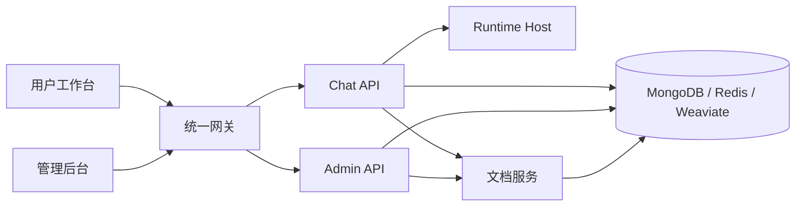

# MOVO

可私有化部署的企业 Agent 平台。

## 项目简介

MOVO 是一个可在自己服务器上部署的企业 Agent 平台，通过 Docker Compose 一次启动用户工作台、管理后台、API、文档处理、检索和基础设施。模型服务由部署者自行配置，应用数据、企业知识和运行服务都保留在自己的环境中。

主要能力：

| 能力 | 说明 |
| --- | --- |
| Agent Runtime | 内置 Runtime Host，支持任务规划、工具调用、Skill、子智能体和受控执行。 |
| 企业知识与研究 | 检索内部文档和公开信息，执行多轮研究并保留引用。 |
| 文档与多模态理解 | 解析 PDF、DOCX、XLSX、PPTX、CSV、Markdown 以及文档中的图片和图表。 |
| 内容与文件生成 | 生成报告、文章、PPTX、电子表格、PDF 和 Markdown。 |
| Skill、工具与 MCP | 复用工作流，通过 HTTP 或 MCP 服务连接业务系统。 |
| 自动化与治理 | 定时任务、敏感操作审批、执行追踪和产物留存。 |
| 管理后台 | 管理组织、用户、角色、模型、知识、Skill、工具、审计记录和运行状态。 |

## 快速启动

环境要求：

- Git
- Docker Desktop，或 Docker Engine 与 Docker Compose v2
- 至少 8 GB 可用内存、20 GB 可用磁盘
- 至少一个兼容模型 API 的访问凭证

在 Linux / macOS 上执行：

```bash
git clone https://github.com/BA-de-BA-jiao-shen-me/movo.git
cd movo
chmod +x movo
./movo --lang zh-CN --mirror cn up
```

然后打开 `http://localhost:3000/admin/setup` 完成初始化（创建组织和初始账号、连接默认对话模型，可选配置 Embedding、Rerank、Vision、图片生成和联网搜索）。

说明：

- 启动器会拉取预构建镜像、等待服务健康并输出初始化地址，无需创建 `.env`。
- `--mirror cn` 使用国内镜像源；不带该参数时使用 GHCR 和 Docker Hub。升级时执行 `./movo --lang zh-CN --mirror cn update`。
- 也可以直接执行 `docker compose up -d` 启动（不含启动器的重试与健康等待）。
- Windows 用户请在 WSL 2 的 Ubuntu 发行版中运行（先用 `wsl -l -v` 确认，再 `wsl -d Ubuntu` 进入），不要在 `docker-desktop` 内部发行版中执行。

初始化完成后：

| 入口 | 默认地址 | 用途 |
| --- | --- | --- |
| 用户工作台 | `http://localhost:3000/` | 对话、研究、知识、文件和内容生成 |
| 管理后台 | `http://localhost:3000/admin/` | 用户、模型、知识、Skill、工具和治理配置 |
| 初始化向导 | `http://localhost:3000/admin/setup` | 仅用于首次初始化 |

## 常用运维命令

```bash
./movo status
./movo logs chat-api
./movo restart
./movo update
./movo fix       # 仅在升级提示会话序号冲突时使用；会暂时停止聊天
./movo backup /path/on/a/large-disk/movo-backup
./movo down       # 停止容器并保留数据
./movo down -v    # 确认后永久删除 MOVO 数据
```

生产部署建议固定版本标签而不是使用 `latest`，升级前先备份数据。

## 配置

默认不需要 `.env`。如需修改端口、访问地址、镜像版本或数据卷前缀：

```bash
cp .env.example .env
```

```env
MOVO_PORT=3000
MOVO_VOLUME_PREFIX=movo
MOVO_IMAGE_PREFIX=ghcr.io/himovo/movo
MOVO_VERSION=vX.Y.Z
PUBLIC_BASE_URL=https://movo.example.com
```

首次启动后请保持 `MOVO_VOLUME_PREFIX` 不变。DNS、TLS 证书和反向代理由部署者自行配置。若在 `.env` 中固定了 `MOVO_VERSION`，所选镜像源必须存在相同标签。

## 从源码构建

```bash
./movo up --build   # 构建并启动
./movo build        # 只构建镜像
```

源码构建需下载 Playwright、LibreOffice、Docling 和模型资源，耗时和磁盘占用比预构建镜像更多。`--build` 不要与 `--mirror cn` 合用。

## 系统架构



默认部署启动 12 个服务：统一网关、两个 Web 应用、三个应用 API、Runtime Host、文档 Worker、MongoDB、Redis、Weaviate，以及一次性的密钥初始化服务。

## 仓库结构

| 路径 | 组件 |
| --- | --- |
| `apps/user-web/` | Vue 3 用户工作台 |
| `apps/admin-web/` | Vue 3 初始化与管理后台 |
| `services/chat-api/` | FastAPI 对话、任务、Agent 和 Skill 服务 |
| `services/chat-api/dsh/runtime-host/` | Node.js Runtime Host |
| `services/admin-api/` | FastAPI 组织、用户、模型和平台管理 API |
| `services/document-parser/` | 文档解析、预览、检索 API 和 Worker |
| `deploy/` | 初始化与统一网关配置 |

## 开发检查

提交改动前请按 [CONTRIBUTING.md](CONTRIBUTING.md) 运行检查，至少执行：

```bash
python3 scripts/check_open_source_hygiene.py
```

## 许可证

见 [LICENSE](LICENSE)。
