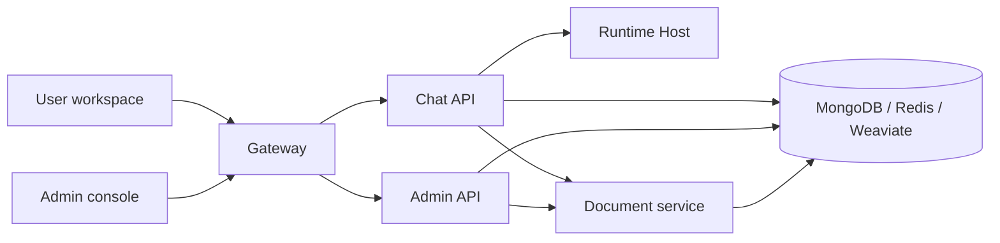

<p align="center">
  
</p>

<h1 align="center">MOVO</h1>

<p align="center">
  A self-hosted enterprise Agent platform.
</p>

<p align="center">
  <strong>English</strong> · <a href="README.zh-CN.md">简体中文</a>
</p>

## Overview

MOVO is an enterprise Agent platform you deploy on your own servers. One Docker Compose deployment starts the user workspace, admin console, APIs, document processing, retrieval and infrastructure. You configure your own model providers, and application data, enterprise knowledge and runtime services stay in your environment.

Key capabilities:

| Capability | Description |
| --- | --- |
| Agent Runtime | Built-in Runtime Host with planning, tool calls, Skills, sub-agents and controlled execution. |
| Knowledge & research | Search internal documents and public sources, run multi-step research with citations. |
| Document & multimodal understanding | Parse PDF, DOCX, XLSX, PPTX, CSV, Markdown, plus images and charts inside documents. |
| Content & file generation | Produce reports, articles, PPTX decks, spreadsheets, PDF and Markdown. |
| Skills, tools & MCP | Reuse workflows and connect business systems over HTTP or MCP. |
| Automation & governance | Scheduled tasks, approvals for sensitive actions, execution tracing and artifact retention. |
| Admin console | Manage organizations, users, roles, models, knowledge, Skills, tools, audit logs and health. |

## Quick start

Requirements:

- Git
- Docker Desktop, or Docker Engine with Docker Compose v2
- At least 8 GB free RAM and 20 GB free disk
- Credentials for at least one compatible model API

On Linux / macOS:

```bash
git clone https://github.com/BA-de-BA-jiao-shen-me/movo.git
cd movo
chmod +x movo
./movo up
```

Then open `http://localhost:3000/admin/setup` to finish setup (create the organization and first account, connect a default chat model; optionally configure Embedding, Rerank, Vision, image generation and web search).

Notes:

- The launcher pulls prebuilt images, waits for services to become healthy and prints the setup URL. No `.env` file is needed.
- In mainland China, add `--mirror cn` (e.g. `./movo --lang zh-CN --mirror cn up`) to use the domestic mirror; otherwise GHCR and Docker Hub are used. Upgrade with `./movo update` (same flags).
- You can also run `docker compose up -d` directly (without the launcher's retries and health waits).
- On Windows, run MOVO inside an Ubuntu distribution on WSL 2 (check with `wsl -l -v`, enter with `wsl -d Ubuntu`), not inside the internal `docker-desktop` distribution.

After setup:

| Entry | Default URL | Purpose |
| --- | --- | --- |
| User workspace | `http://localhost:3000/` | Chat, research, knowledge, files and content generation |
| Admin console | `http://localhost:3000/admin/` | Users, models, knowledge, Skills, tools and governance |
| Setup wizard | `http://localhost:3000/admin/setup` | First-time setup only |

## Operations

```bash
./movo status
./movo logs chat-api
./movo restart
./movo update
./movo fix       # only when an upgrade reports a conversation sequence conflict; pauses chat
./movo backup /path/on/a/large-disk/movo-backup
./movo down       # stop containers, keep data
./movo down -v    # permanently delete MOVO data after confirmation
```

Pin a version tag instead of `latest` in production, and back up before upgrading.

## Configuration

No `.env` is required by default. To change the port, public URL, image version or volume prefix:

```bash
cp .env.example .env
```

```env
MOVO_PORT=3000
MOVO_VOLUME_PREFIX=movo
MOVO_IMAGE_PREFIX=ghcr.io/himovo/movo
MOVO_VERSION=vX.Y.Z
PUBLIC_BASE_URL=https://movo.example.com
```

Keep `MOVO_VOLUME_PREFIX` unchanged after the first start. DNS, TLS and reverse proxies are up to the operator. If you pin `MOVO_VERSION`, the selected registry must have that tag.

## Build from source

```bash
./movo up --build   # build and start
./movo build        # build images only
```

Source builds download Playwright, LibreOffice, Docling and model assets, so they take more time and disk than prebuilt images. Do not combine `--build` with `--mirror cn`.

## Architecture



The default deployment starts 12 services: gateway, two web apps, three application APIs, Runtime Host, document worker, MongoDB, Redis, Weaviate and a one-shot secrets bootstrap.

## Repository layout

| Path | Component |
| --- | --- |
| `apps/user-web/` | Vue 3 user workspace |
| `apps/admin-web/` | Vue 3 setup and admin console |
| `services/chat-api/` | FastAPI chat, task, Agent and Skill service |
| `services/chat-api/dsh/runtime-host/` | Node.js Runtime Host |
| `services/admin-api/` | FastAPI organization, user, model and platform API |
| `services/document-parser/` | Document parsing, preview, retrieval API and worker |
| `deploy/` | Bootstrap and gateway configuration |

## Development checks

Before submitting changes, run the checks in [CONTRIBUTING.md](CONTRIBUTING.md), at minimum:

```bash
python3 scripts/check_open_source_hygiene.py
```

## License

See [LICENSE](LICENSE).
